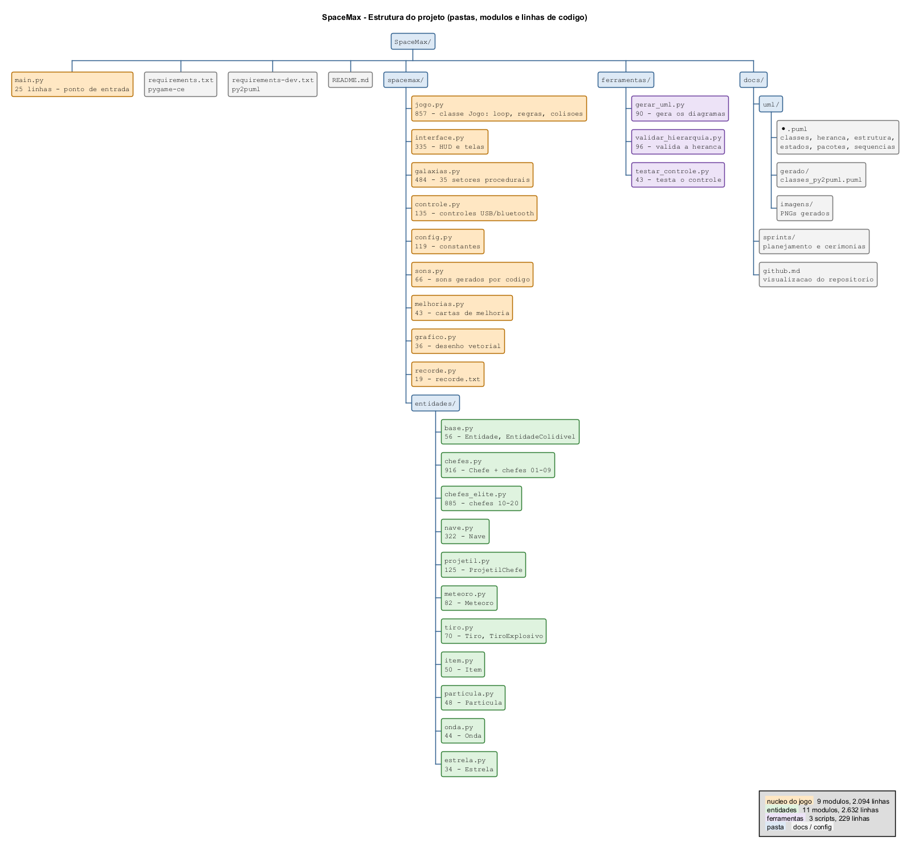
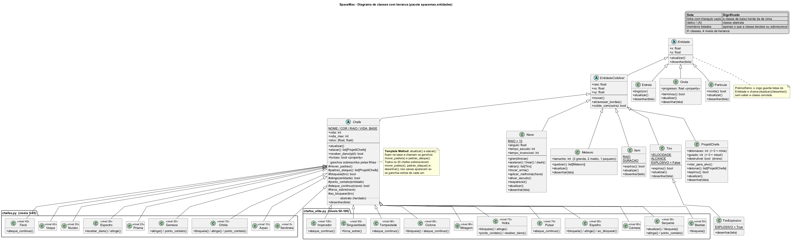
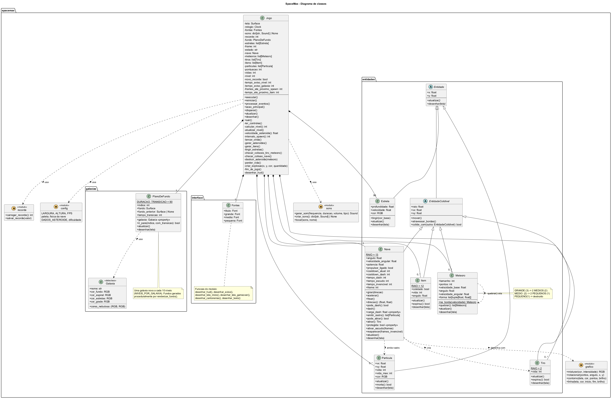

# SpaceMax

Jogo 2D de acao e pontuacao infinita feito em Python com pygame, no estilo do
Asteroids classico e com visual tech minimalista (graficos vetoriais em linhas
finas, fonte monoespacada, grade tecnica ao fundo). Pilote uma nave que gira
360 graus e voa com inercia, quebre os asteroides em pedacos cada vez menores e
viaje por galaxias diferentes a cada 3 niveis.

## Como jogar

- **Seta esquerda/direita ou A/D**: gira a nave (o giro acelera suavemente e para rapido ao soltar)
- **Seta para cima ou W**: acelera (o motor ganha potencia aos poucos e a nave mantem o embalo)
- **Seta para baixo ou S**: freia
- **CONTROL**: impulso, uma arrancada rapida para frente (ilimitado, sem recarga)
- **ESPACO**: atira na direcao em que a nave aponta
- **Q ou TAB**: troca entre a arma normal e a explosiva
- **ESC**: sai do jogo
- **P, ENTER ou ESC**: pausa (no pause, ESC volta ao menu inicial)
- **F11 ou ALT+ENTER**: tela cheia
- Na tela inicial, ESPACO/clique abre a escolha de modo (setas ou 1-5, ENTER para iniciar)
- No Game Over, ESPACO/clique joga o mesmo modo de novo e **M** escolhe outro modo

## Modos de jogo (multiplayer local)

| # | Modo | Jogadores | Como funciona |
| --- | --- | --- | --- |
| 1 | Solo | 1 | Voce contra os asteroides e os 20 chefes (recorde em `recorde.txt`) |
| 2 | Cooperativo | 2 | Os dois contra os asteroides e os chefes. Cada um tem 5 vidas e as proprias melhorias; os pontos somam. Quem zera as vidas fica fora, e **um escudo coletado pelo parceiro revive o eliminado** (com 2 vidas). Game over quando os dois caem (recorde da equipe em `recorde_coop.txt`) |
| 3 | Duelo | 2 | Os tiros e as explosoes ferem o outro jogador; os asteroides atrapalham os dois. 3 vidas por round, vence o round quem sobrar e a partida quem ganhar 2 rounds. Escudo bloqueia tiros e a invencibilidade apos ser atingido deixa os tiros passarem |
| 4 | Corrida de pontos | 2 | Os dois quebram asteroides e os pontos vao para quem acertou o tiro. Vence quem tiver mais pontos em 3 minutos. Quem perde as 3 vidas fica fora; se o ultimo vivo ja estiver na frente, a partida acaba na hora |
| 5 | Sobrevivencia | 2 | Asteroides cada vez mais rapidos (a cada 12 s), sem fogo amigo. Vence quem durar mais: quem ainda estiver vivo quando o outro perder as 3 vidas |

Nos modos de dois jogadores o chefe e os misseis miram a nave viva mais proxima. Chefes e
melhorias existem so no Solo e no Cooperativo (nos modos competitivos todo mundo luta com a
mesma nave). O nivel sobe com o tempo nos modos competitivos.

### Teclas dos dois jogadores (mesmo teclado, ou com controles: veja abaixo)

| Acao | Jogador 1 (ciano) | Jogador 2 (rosa) |
| --- | --- | --- |
| Girar | A / D | Seta esquerda / direita |
| Acelerar / frear | W / S | Seta cima / baixo |
| Atirar | ESPACO | SHIFT direito |
| Impulso | CONTROL esquerdo | CONTROL direito |
| Trocar arma | Q ou TAB | / |

Pausa (P, ENTER ou ESC) e tela cheia (F11) valem para os dois. No multiplayer o mouse
nao atira. No game over o ESPACO so reinicia depois de ~1 segundo, para quem estava
atirando nao reiniciar sem querer.

### Controle (USB ou bluetooth)

Qualquer controle reconhecido pelo SDL (Xbox, PlayStation, Switch Pro, 8BitDo...)
funciona, inclusive conectado com o jogo ja aberto:

- **Analogico esquerdo / direcional**: gira; para cima acelera, para baixo freia
- **A** ou **RB**: atira (segure para disparo continuo)
- **RT** acelera / **LT** freia
- **B**: impulso
- **X**, **Y** ou **LB**: troca de arma
- **START**: pausa / continua (no pause, **SELECT** volta ao menu e **Y** alterna a tela cheia)
- **START** ou **A**: (re)comeca na tela inicial / Game Over
- Na escolha de melhoria: direcional/analogico escolhe a carta e **A** confirma

O jogo pausa sozinho se o controle desconectar ou a janela perder o foco.

Na escolha de modo: direcional/analogico escolhem, **A** ou **START** confirmam e **B** volta.
No Game Over, **SELECT** escolhe outro modo.

#### Tela de jogadores (modos de 2 jogadores)

Depois de escolher um modo de dois jogadores aparece a tela **ESCOLHA OS JOGADORES**: cada um
entra com o proprio controle ou teclado e escolhe se e o jogador 1 (ciano) ou o 2 (rosa).
Da para jogar controle x controle, controle x teclado ou os dois no mesmo teclado.

| | Entrar | Escolher J1 / J2 | Sair |
| --- | --- | --- | --- |
| Controle | **A** (na primeira vaga livre) | direcional ou analogico esquerda / direita | **B** |
| Teclado WASD | **ESPACO** | **A** / **D** | **S** |
| Teclado setas | **SHIFT direito** | **seta esquerda** / **seta direita** | **seta baixo** |

Com os dois prontos, **ENTER** ou **START** comecam. Quem escolhe uma vaga ocupada troca de
lugar com quem estava nela. ESC ou B (sem vaga) voltam. As escolhas ficam guardadas para
"jogar de novo"; se um controle desconectar, a tela de jogadores abre de novo. Cada controle
manda so na nave de quem o escolheu (na partida, **X**, **Y** ou **LB** trocam a arma).

A nave, os tiros e os asteroides atravessam as bordas da tela e reaparecem do
lado oposto. Os asteroides chegam por todos os lados.

## Asteroides que se quebram

| Tamanho | Ao ser atingido | Pontos |
| --- | --- | --- |
| Grande | quebra em 2 medios | 20 |
| Medio | quebra em 2 pequenos (mais rapidos) | 50 |
| Pequeno | e destruido | 100 |

Se um asteroide colidir com a nave, uma vida e perdida (voce comeca com 5) e a
nave reaparece no centro, piscando e invencivel por 2 segundos. A cada 3000
pontos o jogador ganha uma vida extra, ate o limite de 5 vidas. A
cada 9-14 segundos surge um item ambar em forma de losango (ate 2 na tela):
ele da um escudo de 5 segundos que destroi os asteroides em que a nave
encostar. Pegar o escudo solta uma onda de choque ambar, e cada asteroide
esmagado pelo escudo gera onda de impacto, faiscas e um tremor na tela.

## Niveis e galaxias

A cada 1000 pontos o jogador sobe de nivel: os asteroides ficam mais rapidos e
aparecem com mais frequencia. **A cada 3 niveis a nave chega a uma nova
galaxia** (novo "setor"). Cada setor tem um tipo de cenario diferente do anterior
(galaxia espiral, nebulosa, aglomerado, buraco negro, planeta com aneis, cinturao
de asteroides, supernova, estrela binaria ou galaxia eliptica) e cores proprias:

| Setor | Niveis | Nome | Cenario |
| --- | --- | --- | --- |
| 01 | 1-3 | Via Lactea | galaxia espiral |
| 02 | 4-6 | Nebulosa De Orion | nebulosa |
| 03 | 7-9 | Andromeda | galaxia espiral |
| 04 | 10-12 | Pleiades | aglomerado de estrelas |
| 05 | 13-15 | Kepler-22 | planeta com aneis |
| 06 | 16-18 | Nuvem De Magalhaes | galaxia espiral |
| 07 | 19-21 | Sagitario A* | buraco negro |
| 08 | 22-24 | Cinturao De Kuiper | cinturao de asteroides |
| 09 | 25-27 | Triangulo | galaxia espiral |
| 10 | 28-30 | Nebulosa Do Caranguejo | supernova |
| 11 | 31-33 | Alfa Centauri | estrela binaria |
| 12 | 34-36 | M87 | galaxia eliptica |
| 13 | 37-39 | Sombrero | galaxia espiral |
| 14 | 40-42 | Nebulosa Da Aguia | nebulosa |
| 15 | 43-45 | Omega Centauri | aglomerado de estrelas |
| 16 | 46-48 | Trappist-1 | planeta com aneis |
| 17 | 49-51 | Redemoinho | galaxia espiral |
| 18 | 52-54 | Cygnus X-1 | buraco negro |
| 19 | 55-57 | Cinturao Principal | cinturao de asteroides |
| 20 | 58-60 | Betelgeuse | supernova |
| 21 | 61-63 | Catavento | galaxia espiral |
| 22 | 64-66 | Sirius | estrela binaria |
| 23 | 67-69 | Maffei 1 | galaxia eliptica |
| 24 | 70-72 | Nebulosa Da Helice | nebulosa |
| 25 | 73-75 | Girassol | galaxia espiral |
| 26 | 76-78 | Aglomerado De Hercules | aglomerado de estrelas |
| 27 | 79-81 | Proxima B | planeta com aneis |
| 28 | 82-84 | Charuto | galaxia espiral |
| 29 | 85-87 | Ton 618 | buraco negro |
| 30 | 88-90 | Nuvem De Oort | cinturao de asteroides |
| 31 | 91-93 | Olho Negro | galaxia espiral |
| 32 | 94-96 | Sn 1987A | supernova |
| 33 | 97-99 | Roda De Carro | galaxia espiral |
| 34 | 100-102 | Grande Atrator | buraco negro |
| 35 | 103-105 | Girino | galaxia espiral |

O nivel 100 cai no setor 34 (Grande Atrator). Depois do setor 35 o ciclo recomeca. Os fundos sao gerados por codigo
(`spacemax/galaxias.py`), sem arquivos de imagem.

## Melhorias da nave

**A cada 6 niveis (6, 12, 18...) e a cada chefe derrotado o jogo pausa e
oferece 3 cartas sorteadas**; o jogador
escolhe uma (setas + ENTER, teclas 1/2/3, clique, ou direcional + A no
controle). A nave pode receber **no maximo 10 melhorias por partida**; o
contador aparece na tela de escolha e no pause.

| Melhoria | Efeito por nivel | Max |
| --- | --- | --- |
| Cadencia | atira 15% mais rapido | 4 |
| Tiro multiplo | +1 tiro em leque | 2 |
| Alcance | tiros vao 25% mais longe | 3 |
| Motor | +12% aceleracao e velocidade | 3 |
| Manobra | gira 15% mais rapido | 3 |
| Escudo longo | escudo dura +2 s | 3 |
| Arsenal | +1 tiro explosivo | 3 |
| Recarga | explosivos recarregam 25% antes | 3 |
| Reparo | recupera 1 vida (so aparece sem vida cheia) | - |

## Arma explosiva

Com **Q** ou **TAB** a nave alterna entre a arma normal e a **explosiva**. A
explosiva tem **3 tiros**: o disparo e mais lento e explode ao acertar algo (ou
ao fim do alcance), quebrando os asteroides na area, apagando os projeteis dos
chefes e causando dano extra no chefe. Os 3 tiros voltam juntos **30 segundos**
depois do primeiro disparo. O canto inferior esquerdo mostra a arma atual, os
tiros restantes e a barra de recarga.

## Chefes

**A cada 5 niveis (5, 10, 15...) aparece um chefe.** Durante a luta os
asteroides continuam chegando (com menos frequencia) e o nivel fica congelado
ate o chefe ser derrotado, o que vale 1500 pontos. Cada chefe tem mais vida e
ataca mais rapido que o anterior. Uma barra de vida aparece na base da tela. Abaixo de metade da
vida o chefe fica "furioso" e ataca mais rapido. Encostar nele sem escudo custa
uma vida; com escudo, a nave e empurrada para longe e causa dano.

| # | Nivel | Chefe | Forma | Ataque |
| --- | --- | --- | --- | --- |
| 01 | 5 | Sentinela (vermelho) | hexagono com anel segmentado | rajadas em circulo |
| 02 | 10 | Arpao (violeta) | ponta de flecha que vira para a nave | leque de tiros mirados |
| 03 | 15 | Orbita (verde) | losango com 3 satelites | espiral; os satelites bloqueiam tiros e tambem atiram |
| 04 | 20 | Gemeos (amarelo claro) | dois triangulos orbitando um centro vazio | tiros mirados alternados e cruzes; so os gemeos levam dano |
| 05 | 25 | Prisma (rosa) | quadrado duplo | mira (linha tracejada), investe contra a nave e solta um anel |
| 06 | 30 | Espectro (azul) | fantasma | some (intocavel), reaparece longe da nave soltando um anel; furioso deixa minas |
| 07 | 35 | Nucleo (laranja) | aneis concentricos | espiral dupla e minas que explodem em estilhacos |
| 08 | 40 | Vespa (verde-limao) | inseto com asas | misseis teleguiados e ferrao mirado |
| 09 | 45 | Farol (branco) | octogono com lampada | laser que varre a tela (a mira tracejada avisa antes); furioso usa dois feixes |

| 10 | 50 | Bastiao (azul) | hexagono com escudo em arco | o escudo (240 graus) gira para a nave e bloqueia tiros; o ponto fraco sao as costas |
| 11 | 55 | Serpente (verde) | cabeca com 12 segmentos | so a cabeca leva dano; o corpo bloqueia tiros e machuca; tiros da cabeca e da cauda |
| 12 | 60 | Colmeia (mel) | hexagono com favos | solta drones cacadores que podem ser abatidos (+25 pontos cada) |
| 13 | 65 | Espelho (prata) | losango com duas placas | as placas refletem os tiros de volta; mire no vao estreito entre elas |
| 14 | 70 | Pulsar (rosa) | estrela pulsante | aneis que crescem pela tela; passe pelo vao de cada anel |
| 15 | 75 | Hidra (turquesa) | nucleo com 3 cabecas | o nucleo e blindado ate as 3 cabecas cairem; cada cabeca solta um anel ao cair |
| 16 | 80 | Miragem (lilas) | 3 pentagonos iguais | so a copia verdadeira leva dano (so ela pisca ao ser atingida); embaralham a cada 6 s |
| 17 | 85 | Ciclone (agua) | triangulo com bracos | bracos giratorios bloqueiam tiros e cortam a nave; o giro inverte (os bracos piscam antes) |
| 18 | 90 | Tempestade (azul claro) | nuvem | marca pontos no chao e um raio cai neles 1 s depois; chuva de tiros |
| 19 | 95 | Singularidade (laranja) | buraco negro | gravidade puxa a nave; jatos giratorios e aneis |
| 20 | 100 | Imperador (dourado) | estrela de 8 pontas | alterna 3 fases: aneis e leque, laser giratorio, misseis e minas |

Depois do 20o chefe (nivel 100) cada novo chefe e sorteado entre os 20, sem
repetir o anterior, e fica cada vez mais forte (mais vida, tiros mais rapidos e
frequentes).

## Elementos implementados

- Nave vetorial que gira 360 graus com giro progressivo, acelera com inercia, freia, usa impulso (CONTROL) e atira na direcao em que aponta
- Rastro de exaustao do motor, jatos laterais ao girar e rastro fantasma durante o impulso
- Asteroides que se quebram em pedacos menores (grande -> medio -> pequeno)
- Tela sem bordas: tudo atravessa as laterais e reaparece do outro lado
- 35 setores com planos de fundo procedurais de 9 tipos (espiral, nebulosa, buraco negro, planeta...), um a cada 3 niveis, com transicao suave
- Sistema de pontuacao por tamanho de asteroide + recorde salvo em `recorde.txt`
- Niveis com dificuldade progressiva (velocidade e frequencia dos asteroides)
- Sistema de vidas com reaparecimento e invencibilidade temporaria
- Colisao circular (tiro-asteroide, nave-asteroide, nave-item)
- HUD minimalista (pontos, vidas, nivel, setor/galaxia, recorde) e avisos animados
- Tela inicial (com asteroides flutuando ao fundo) e tela de Game Over
- Efeitos sonoros gerados por codigo (sem precisar de arquivos de audio)
- Faiscas de explosao, ondas de choque e tremor de tela (ao pegar escudo, bater com escudo e ser atingido)
- Vinte chefes diferentes (ate o nivel 100), um a cada 5 niveis, com barra de vida e aviso de entrada
- Multiplayer local para 2 jogadores no mesmo teclado ou com 2 controles: modo cooperativo (com revive) e modos competitivos (duelo, corrida de pontos e sobrevivencia)

## Estrutura do projeto

```
SpaceMax/
├── main.py                 # ponto de entrada (apenas inicia o jogo)
├── requirements.txt
├── requirements-dev.txt    # dependencias de desenvolvimento (py2puml)
├── docs/
│   ├── uml/                # diagramas PlantUML (.puml) e imagens geradas
│   ├── sprints/            # planejamento, cerimonias e backlog das sprints
│   └── github.md           # visualizacao do historico do repositorio
├── ferramentas/
│   ├── gerar_uml.py        # gera os diagramas com py2puml + PlantUML
│   ├── validar_hierarquia.py # valida a heranca das entidades
│   └── testar_controle.py  # mostra no terminal os botoes lidos do controle
└── spacemax/
    ├── config.py           # constantes: tela, paleta, fisica, dificuldade
    ├── jogo.py             # classe Jogo: loop principal, regras e colisoes
    ├── modos.py            # modos de jogo (solo, coop, duelo, corrida, sobrevivencia) e suas regras
    ├── jogador.py          # Jogador: nave, teclas, vidas e pontos de cada um
    ├── galaxias.py         # planos de fundo: um setor (cenario) a cada 3 niveis
    ├── grafico.py          # primitivas de desenho vetorial (linhas com brilho)
    ├── interface.py        # HUD, avisos, telas de inicio, pause, melhoria e Game Over
    ├── controle.py         # controles USB/bluetooth (SDL GameController)
    ├── melhorias.py        # melhorias da nave e sorteio das cartas
    ├── sons.py             # efeitos sonoros gerados por codigo
    ├── recorde.py          # leitura/gravacao do recorde
    └── entidades/
        ├── base.py         # classes base Entidade e EntidadeColidivel
        ├── nave.py         # nave do jogador
        ├── tiro.py         # tiros
        ├── meteoro.py      # asteroides (quebram em pedacos menores)
        ├── item.py         # item de escudo
        ├── chefes.py       # base dos chefes e chefes 01-09
        ├── chefes_elite.py # chefes 10-20 (niveis 50-100) e a ordem em que aparecem
        ├── projetil.py     # projeteis, minas, misseis e drones dos chefes
        ├── particula.py    # particulas de explosao
        ├── onda.py         # ondas de choque
        └── estrela.py      # estrelas do cenario
```



## Diagramas UML (py2puml + PlantUML)

Os diagramas ficam em `docs/uml/`:

| Arquivo | Conteudo |
| --- | --- |
| `classes.puml` | diagrama de classes completo (atributos, metodos e relacoes) |
| `heranca.puml` | diagrama de classes com toda a heranca das entidades (31 classes) |
| `estrutura.puml` | mapa de pastas e modulos, com tamanho em linhas |
| `estados.puml` | maquina de estados do jogo (Inicio, Jogando, Game Over) |
| `sequencia_partida.puml` | sequencia de uma partida completa (inicio, jogo, game over, reinicio) |
| `sequencia_frame.puml` | sequencia de chamadas em um frame do jogo |
| `pacotes.puml` | dependencias entre os modulos |
| `gerado/classes_py2puml.puml` | diagrama gerado automaticamente a partir do codigo pelo **py2puml** |

As imagens PNG ficam em `docs/uml/imagens/`. Para gerar tudo de novo depois
de mudar o codigo (precisa de Java instalado; o `plantuml.jar` e baixado
automaticamente na primeira vez):

```bash
pip install -r requirements-dev.txt
python ferramentas/gerar_uml.py
```

Antes de gerar os diagramas, o script valida a hierarquia de classes
(`ferramentas/validar_hierarquia.py`, que tambem pode ser executado sozinho).
Se alguma entidade nao herdar de `Entidade`, ou deixar um metodo abstrato sem
implementar, nenhum diagrama e gerado.

```
Entidade (abstrata)            x, y, atualizar(), desenhar()
    +-- EntidadeColidivel (abstrata)   raio, vx, vy, mover(), colide_com()
        +-- Chefe (abstrata)   vida, atacar(); ganchos mover_padrao(), padrao_ataque()
            +-- Sentinela, Arpao, Orbita ... Imperador   (20 chefes)
        +-- Item
        +-- Meteoro
        +-- Nave
        +-- ProjetilChefe
        +-- Tiro
            +-- TiroExplosivo
    +-- Estrela
    +-- Onda
    +-- Particula
```





## Gestao do projeto

- [Sprint 4](docs/sprints/sprint4.md): planejamento, cerimonias e backlog
- [Visualizacao do GitHub](docs/github.md): grafo de commits, autores e atividade

## Instalacao

Requer Python 3.10+.

```bash
pip install -r requirements.txt
```

> Observacao: em Python 3.13/3.14, o pacote `pygame` classico ainda nao tem
> build pre-compilado no PyPI. Por isso o `requirements.txt` usa
> `pygame-ce` (Community Edition), que e 100% compativel — o `import pygame`
> continua igual. Se voce estiver usando Python 3.12 ou anterior, pode trocar
> por `pygame` normalmente.

## Executar

```bash
python main.py
```
