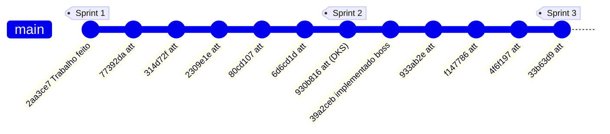
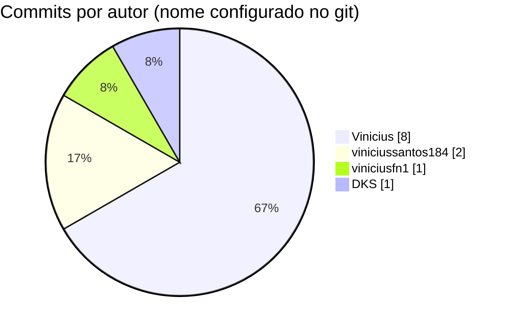
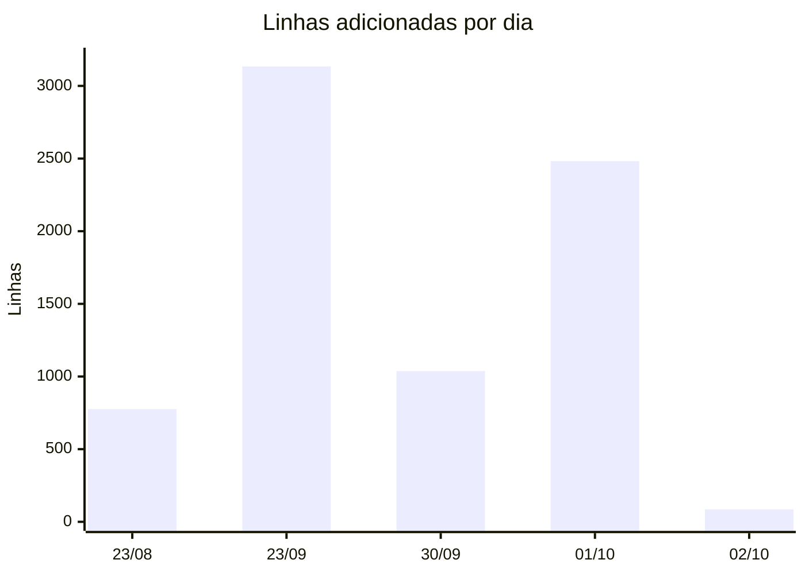

# SpaceMax - Visualizacao do GitHub

Repositorio: <https://github.com/viniciussantos184/SpaceMax>

Os graficos abaixo usam **Mermaid**, que o GitHub desenha automaticamente ao
abrir este arquivo no navegador (no VS Code, use a extensao
"Markdown Preview Mermaid Support"). Dados levantados com `git log` em
07/10/2026 (inicio da Sprint 4).

## Resumo

| Indicador | Valor |
| --- | --- |
| Branch principal | `main` (unica branch, historico linear) |
| Commits | 12 |
| Primeiro commit | 23/08/2026 - "Trabalho feito" |
| Ultimo commit | 02/10/2026 - `33b63d9` |
| Linhas adicionadas / removidas | +7.515 / -1.468 |
| Autores (nome no git) | Vinicius, viniciussantos184, viniciusfn1, DKS |
| Classes Python | 37 (31 na hierarquia de `Entidade`) |

## Linha do tempo dos commits (branch `main`)

Cada ponto e um commit; as etiquetas marcam o fechamento de cada sprint.



## Commits por autor



> `Vinicius` e `viniciussantos184` usam o mesmo e-mail
> (`vinicius.santos184@...`); o GitHub junta os dois no mesmo perfil.

## Linhas adicionadas por dia de trabalho



| Dia | Commits | Arquivos alterados | + linhas | - linhas | Entrega |
| --- | --- | --- | --- | --- | --- |
| 23/08 | 1 | 4 | 776 | 0 | versao inicial do jogo |
| 23/09 | 6 | 92 | 3.134 | 1.243 | reestruturacao em pacotes, entidades e UML |
| 30/09 | 2 | 19 | 1.037 | 37 | primeiro chefe |
| 01/10 | 1 | 17 | 2.482 | 126 | chefes 10-20 (`chefes_elite.py`) |
| 02/10 | 2 | 9 | 86 | 62 | ajustes finais |

## Paginas de visualizacao do proprio GitHub

| O que ver | Onde |
| --- | --- |
| Grafo de branches e commits | [Insights > Network](https://github.com/viniciussantos184/SpaceMax/network) |
| Contribuicoes por pessoa | [Insights > Contributors](https://github.com/viniciussantos184/SpaceMax/graphs/contributors) |
| Atividade semanal | [Insights > Commit activity](https://github.com/viniciussantos184/SpaceMax/graphs/commit-activity) |
| Linhas adicionadas/removidas | [Insights > Code frequency](https://github.com/viniciussantos184/SpaceMax/graphs/code-frequency) |
| Historico de commits | [Commits](https://github.com/viniciussantos184/SpaceMax/commits/main) |

## Como atualizar estes dados

```bash
git log --format="%h | %ad | %an | %s" --date=short   # lista de commits
git shortlog -sne                                    # commits por autor
git log --shortstat --date=short                     # linhas por commit
git log --graph --oneline --all                      # grafo no terminal
```

## Pontos de atencao (para a retrospectiva)

- 10 dos 12 commits tem a mensagem `att`, o que nao diz o que mudou. A
  Sprint 4 adota mensagens descritivas (ex.: `docs: diagrama de heranca`).
- Todo o trabalho vai direto na `main`. Usar uma branch por task e abrir Pull
  Request deixa o grafo do GitHub mostrando o que cada task entregou.
- Os commits ficam concentrados no dia da aula. Commits menores ao longo da
  semana deixam o grafico de atividade mais fiel ao andamento da sprint.
