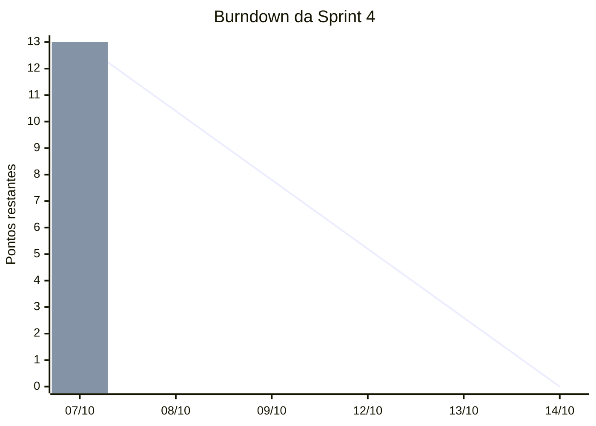

# Sprint 4 - Documentacao visual do SpaceMax

| | |
| --- | --- |
| **Periodo** | 07/10/2026 a 13/10/2026 (1 semana) |
| **Review e Retrospectiva** | 14/10/2026, na aula |
| **Metodologia** | Scrum (sprints semanais) |
| **Repositorio** | <https://github.com/viniciussantos184/SpaceMax> |
| **Capacidade planejada** | 13 story points |

## Objetivo da sprint

> Mostrar **como o SpaceMax e organizado por dentro**: um diagrama de classes
> com toda a heranca do projeto, um mapa visual da estrutura de pastas e
> modulos e uma visualizacao do historico do repositorio no GitHub, tudo
> ligado ao README.

## Time

| Integrante | Papel na sprint |
| --- | --- |
| Vinicius | Product Owner / Desenvolvedor |
| Vitor (DKS) | Scrum Master / Desenvolvedor |

> Ajuste os papeis conforme a divisao combinada pelo grupo.

## Historico das sprints anteriores

Levantado a partir dos commits (detalhes em [../github.md](../github.md)).

| Sprint | Datas | Entrega principal |
| --- | --- | --- |
| 1 | ate 23/08 | versao inicial do jogo (nave, asteroides, pontuacao) |
| 2 | 23/09 | reestruturacao em pacotes, hierarquia de entidades, UML, controles |
| 3 | 30/09 a 02/10 | 20 chefes, arma explosiva, melhorias da nave |
| **4** | **07/10 a 13/10** | **documentacao visual (heranca, estrutura, GitHub)** |

---

# Cerimonias

## 1. Sprint Planning - 07/10/2026

**Duracao:** 1h (timebox) - **Participantes:** todo o time

**Pauta**

1. Revisar o objetivo do produto e o que foi entregue na Sprint 3.
2. Definir o objetivo da Sprint 4.
3. Escolher os itens do Product Backlog que cabem na capacidade (13 pts).
4. Quebrar cada item em tasks e definir responsaveis.
5. Confirmar a Definition of Done.

**Decisoes**

- O objetivo da sprint e documentacao visual; nenhuma mudanca de jogabilidade.
- Entram na sprint as historias US-01, US-02, US-03 e US-04 (13 pontos).
- Os diagramas usam **PlantUML** (ja usado no projeto, gerado por
  `ferramentas/gerar_uml.py`) e o historico do GitHub usa **Mermaid**, que o
  GitHub desenha sozinho no navegador.
- A partir desta sprint as mensagens de commit devem dizer o que mudou
  (ex.: `docs: diagrama de heranca`), em vez de `att`.

## 2. Daily Scrum

**Quando:** todo dia da sprint, 15 minutos (presencial ou no grupo do time).
Cada integrante responde:

1. O que fiz desde a ultima daily?
2. O que vou fazer ate a proxima?
3. Tem algo me bloqueando?

| Data | Integrante | Fez | Vai fazer | Impedimentos |
| --- | --- | --- | --- | --- |
| 07/10 | Vinicius | Planning; diagrama de heranca (T-01 a T-03) | estrutura e GitHub | - |
| 07/10 | Vitor | Planning | revisar diagramas | - |
| 08/10 | | | | |
| 09/10 | | | | |
| 12/10 | | | | |
| 13/10 | | | | |

## 3. Sprint Review - 14/10/2026

**Duracao:** 30 min - **Participantes:** time + professor (stakeholder)

**Roteiro da demonstracao**

1. Abrir `docs/uml/imagens/heranca.png` e explicar os 4 niveis de heranca,
   as classes abstratas e o Template Method dos chefes.
2. Rodar `python ferramentas/validar_hierarquia.py` ao vivo: o script
   imprime a arvore e confirma as 31 classes.
3. Mostrar `docs/uml/imagens/estrutura.png`: pastas, responsabilidade de
   cada modulo e tamanho em linhas.
4. Abrir `docs/github.md` no GitHub: grafo de commits, commits por autor e
   linhas por dia; depois as paginas Insights > Network e Contributors.
5. Mostrar o README atualizado com os links.

**Resultado** (preencher na review)

| Historia | Aceita? | Feedback |
| --- | --- | --- |
| US-01 Diagrama de heranca | | |
| US-02 Estrutura do projeto | | |
| US-03 Visualizacao do GitHub | | |
| US-04 README atualizado | | |

## 4. Sprint Retrospective - 14/10/2026

**Duracao:** 30 min - **Formato:** Comecar / Parar / Continuar

Pontos ja observados no historico do GitHub (para abrir a conversa):

| Comecar | Parar | Continuar |
| --- | --- | --- |
| Usar uma branch por task e abrir Pull Request | Commits com a mensagem `att` (10 de 12) | Gerar os diagramas a partir do codigo (py2puml + validacao) |
| Fazer commits pequenos durante a semana | Concentrar todo o trabalho no dia da aula | Manter o README como porta de entrada do projeto |
| Registrar a daily nesta pagina | | |

**Acoes para a Sprint 5** (preencher na retro)

- [ ] 
- [ ] 

---

# Backlog

## Product Backlog (priorizado)

| ID | Historia | Prioridade | Pontos | Sprint |
| --- | --- | --- | --- | --- |
| US-01 | Como avaliador, quero um **diagrama de classes com a heranca** do projeto para entender como as classes se reaproveitam | Alta | 5 | **4** |
| US-02 | Como novo desenvolvedor, quero **visualizar a estrutura** de pastas e modulos para saber onde fica cada parte do jogo | Alta | 3 | **4** |
| US-03 | Como time, queremos **visualizar o historico do GitHub** para acompanhar quem fez o que e quando | Alta | 3 | **4** |
| US-04 | Como visitante do repositorio, quero que o **README aponte para os diagramas** novos e esteja atualizado | Media | 2 | **4** |
| US-05 | Como jogador, quero um menu de opcoes (volume, tela cheia) | Media | 5 | futura |
| US-06 | Como time, queremos testes automatizados das regras do jogo | Media | 8 | futura |
| US-07 | Como jogador, quero um ranking com os 10 melhores recordes | Baixa | 3 | futura |

## Sprint Backlog (tasks)

Status: `A fazer` / `Fazendo` / `Em revisao` / `Feito`

### US-01 - Diagrama de Classes com Heranca do Projeto (5 pts)

| Task | Descricao | Responsavel | Estimativa | Status |
| --- | --- | --- | --- | --- |
| T-01 | Levantar a arvore de heranca real com `ferramentas/validar_hierarquia.py` | Vinicius | 0,5h | Feito |
| T-02 | Criar `docs/uml/heranca.puml` com as 31 classes de `spacemax.entidades` | Vinicius | 2h | Feito |
| T-03 | Destacar classes abstratas, metodos abstratos e metodos sobrescritos | Vinicius | 1h | Feito |
| T-04 | Agrupar os 20 chefes por modulo (`chefes.py` e `chefes_elite.py`) e anotar o Template Method | Vinicius | 1h | Feito |
| T-05 | Gerar `docs/uml/imagens/heranca.png` | Vinicius | 0,5h | Feito |
| T-06 | Revisar o diagrama comparando com o codigo | Vitor | 1h | Em revisao |

**Criterios de aceite**
- Mostra os 4 niveis: `Entidade` -> `EntidadeColidivel` -> `Chefe`/`Tiro` -> chefes/`TiroExplosivo`.
- Classes abstratas aparecem em italico; heranca com seta de triangulo vazio.
- Todas as 31 classes listadas por `validar_hierarquia.py` estao no diagrama.

### US-02 - Visualizacao da Estrutura (3 pts)

| Task | Descricao | Responsavel | Estimativa | Status |
| --- | --- | --- | --- | --- |
| T-07 | Mapear pastas e modulos e contar as linhas de cada arquivo | Vinicius | 0,5h | Feito |
| T-08 | Criar `docs/uml/estrutura.puml` (arvore WBS colorida por camada) | Vinicius | 1,5h | Feito |
| T-09 | Gerar `docs/uml/imagens/estrutura.png` | Vinicius | 0,5h | Feito |
| T-10 | Revisar a responsabilidade descrita para cada modulo | Vitor | 0,5h | Em revisao |

**Criterios de aceite**
- Todo arquivo `.py` do repositorio aparece com sua responsabilidade.
- Cores separam nucleo do jogo, entidades, ferramentas e documentacao.

### US-03 - Visualizacao do GitHub (3 pts)

| Task | Descricao | Responsavel | Estimativa | Status |
| --- | --- | --- | --- | --- |
| T-11 | Levantar commits, autores e linhas alteradas com `git log` | Vinicius | 0,5h | Feito |
| T-12 | Criar `docs/github.md` com grafo de commits, pizza por autor e barras por dia (Mermaid) | Vinicius | 1,5h | Feito |
| T-13 | Listar os links das paginas Insights do GitHub (Network, Contributors...) | Vinicius | 0,5h | Feito |
| T-14 | Conferir que os graficos Mermaid aparecem no GitHub depois do push | Vitor | 0,5h | A fazer |

**Criterios de aceite**
- O arquivo abre no GitHub com os graficos desenhados.
- Os numeros batem com `git shortlog -sne` e `git log --shortstat`.

### US-04 - README atualizado (2 pts)

| Task | Descricao | Responsavel | Estimativa | Status |
| --- | --- | --- | --- | --- |
| T-15 | Atualizar a arvore de heranca do README (faltavam `Chefe`, `Onda`, `ProjetilChefe`, `TiroExplosivo`) | Vinicius | 0,5h | Feito |
| T-16 | Atualizar a estrutura do projeto e a tabela de diagramas no README | Vinicius | 0,5h | Feito |
| T-17 | Adicionar links para a Sprint 4 e para `docs/github.md` | Vinicius | 0,5h | Feito |
| T-18 | Commit com mensagem descritiva e push para o GitHub | Vitor | 0,5h | A fazer |

## Definition of Ready

- A historia tem descricao no formato "Como... quero... para...".
- Tem criterios de aceite e estimativa em pontos.
- O time sabe por onde comecar.

## Definition of Done

- O artefato esta no repositorio (fonte `.puml`/`.md` **e** imagem quando houver).
- `python ferramentas/gerar_uml.py` roda sem erro.
- Revisado por outro integrante.
- Linkado no README.
- Commit com mensagem descritiva enviado para a `main`.

## Burndown (pontos restantes)

A linha e o ritmo ideal; as barras sao o real. Atualize o vetor `bar`
a cada daily com os pontos que ainda faltam.
